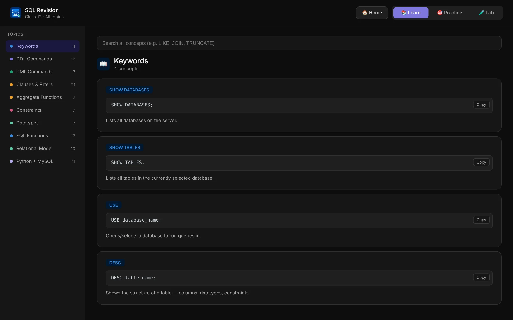
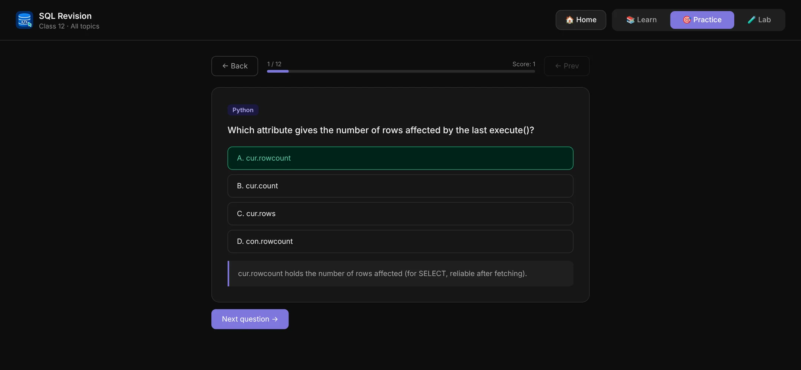
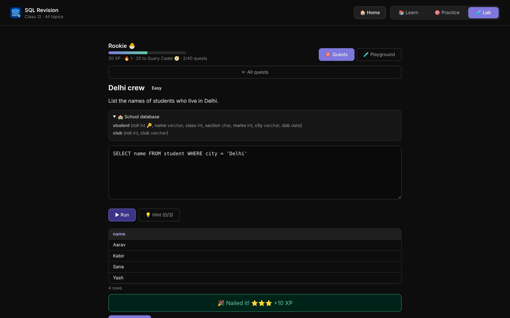

# SQL Revision · Class 12

**SQL, finally clicks.** A free revision app for Class 12 SQL: every topic as bite-sized cards, instant-feedback quizzes, and a live query lab that runs real SQL in your browser. No sign-up, no install, works offline.

[**Repository**](https://github.com/pavithrasajunair-ship-it/sql-web) · [**Author**](https://github.com/pavithrasajunair-ship-it)

<p align="center">
  
  
  
</p>

---

## Features

### 📚 Learn
- **98 revision cards** across **10 topics**: Keywords, DDL Commands, DML Commands, Clauses & Filters, Aggregate Functions, Constraints, Datatypes, SQL Functions, Relational Model, and Python + MySQL.
- Each card has the exact syntax, a one-line explanation and one-tap copy.
- Search any keyword across every concept.

### 🎯 Practice
- **107 practice questions**: multiple-choice and type-the-answer.
- Instant feedback with an explanation for every question.
- Typed answers are graded the way a teacher would: keywords can be upper or lower case, but table and column names are case-sensitive.
- **Smart Review** (spaced repetition) brings cards back just before you would forget them.
- Flashcard drills, optional timers, a Mock Exam, and quizzes that resume after a refresh with the same questions.

### 🧪 Lab
- A built-in SQL engine that runs your queries on sample databases, entirely in the browser.
- **40 hands-on quests** across five practice databases, with XP, ranks and a daily streak.
- Hints when you are stuck, and "did you mean…?" suggestions for typos.
- A free-play playground that remembers your tables between visits.

### Everywhere
- **Offline-ready.** Installable as a PWA; works without a connection after the first visit.
- **Private.** Progress lives in your browser's local storage. Nothing is uploaded.
- **Portable.** Export and import your progress to move between devices.
- Dark and light themes, a big-text mode, keyboard shortcuts, and a responsive layout for phones.
- A marketing homepage with a launch film (16:9 for desktop, 9:16 for phones).

---

## Quick start

Open the live site, or run it locally. It is a static site with no dependencies.

```bash
git clone https://github.com/pavithrasajunair-ship-it/sql-web.git
cd sql-web
python3 -m http.server 8000
# then visit http://localhost:8000
```

Use a local server (not `file://`) so the service worker, offline mode and the launch film work.

Add `#app` to the URL (for example `http://localhost:8000/#app`) to skip the homepage and open the app directly.

### Deploy with GitHub Pages
1. Go to **Settings → Pages**.
2. Under **Build and deployment**, choose **Deploy from a branch**, then select `main` and the `/ (root)` folder.
3. Save. The site appears at `https://pavithrasajunair-ship-it.github.io/sql-web/`.

The repo root is a ready-to-serve build. `dist/` holds an identical copy for hosts such as Netlify, Cloudflare Pages or Vercel (it also includes a `_headers` file for cache rules).

---

## Project structure

```
sql-web/
├── index.html            Built single-file app (CSS + JS inlined). Served by GitHub Pages.
├── sw.js, manifest.webmanifest, icons, favicons    PWA and offline support
├── launch.mp4, launch-vertical.mp4, *-poster.jpg   Launch film (desktop and phone cuts)
├── shot-*.webp           Real app screenshots used on the homepage
├── dist/                 Deploy-ready copy of the build
├── src/                  Source files
│   ├── index.html        Markup (homepage + app shell)
│   ├── styles.css        All styles (dark/light themes, landing page)
│   ├── data.js           Topics, cards, MCQs and typed questions
│   ├── grader.js         Typed-answer grading
│   ├── sqlengine.js      In-browser SQL engine used by the Lab
│   ├── lab.js            Quests, XP, playground
│   ├── exam.js           Mock Exam mode
│   ├── app.js            App logic, routing, practice modes
│   ├── landing.js        Homepage scroll animations and film controls
│   └── sw.js             Service worker template
├── build.js              Inlines src/ into index.html and writes dist/
├── tests/                Unit and end-to-end tests
└── video/                Sources and scripts for the launch film
```

---

## Development

Edit files in `src/`, then rebuild:

```bash
node build.js
```

This regenerates `index.html`, copies assets next to it, writes `dist/`, and stamps the service worker with a new cache version so users receive updates.

### Tests

```bash
node tests/tests.js          # unit tests: question data and grader (436 checks)

pip install playwright && playwright install chromium
python3 tests/e2e.py         # end-to-end suites in headless Chromium
python3 tests/batch1_e2e.py
python3 tests/batch2_e2e.py
python3 tests/lab_e2e.py
python3 tests/flash_shuffle.py
```

### Adding content
Questions and cards live in `src/data.js`. Run `node tests/tests.js` after editing; it checks for unique cards and questions, valid answer indexes, and that every model answer passes the grader.

### Re-rendering the launch film

The film is an HTML composition (`video/composition.html`) captured frame by frame with Chromium and encoded with ffmpeg.

```bash
python3 video/capture.py                                # re-capture real app screens
python3 video/render.py frames /tmp/frames              # 16:9 frames
python3 video/mix.py /tmp/frames /tmp/out               # music + sfx + encode
python3 video/render.py frames /tmp/framesV vertical    # 9:16 frames
python3 video/mix.py /tmp/framesV /tmp/outV vertical
```

Requires Python with Playwright, plus ffmpeg.

---

## Credits

- Film music: *Happy Beats / Business Moves* by Sascha Ende, [ende.app](https://ende.app/en), licensed [CC BY 4.0](https://ende.app/en/standard-license).
- Sound effects: [Kenney.nl](https://kenney.nl/), CC0.
- Film workflow inspired by [/brag](https://github.com/latent-spaces/brag).

## License

No licence has been chosen for this project yet. Until one is added, all rights are reserved by the author. To make it open source, add a `LICENSE` file (for example MIT) and update this section.
